# Inbox — End-to-End Engineering Plan (v4: Go backend + Swift app)

Supersedes `PLAN.md` (v3, Cloudflare-only backend). Source of truth for screens: the **"Inbox: mobile design"** canvas (96 boards: Direction, IA, Onboarding, Mail, Message, Search, Needs attention, Rules, Businesses, Gmail + backfill, Alfather, Settings + health).

---

## 0. TL;DR

| | |
|---|---|
| **What it is** | A read-mostly iOS mailbox for several business domains. Mail still lands in Gmail. Inbox keeps its own copy, sorts it by business and rule, and writes labels/archive back to Gmail. |
| **Ingress** | Cloudflare Email Routing → a **~80-line TypeScript Email Worker** (the only thing Cloudflare lets receive mail). It forwards to Gmail first, drops the raw `.eml` in R2, then pings the Go server. |
| **Backend** | **Go**, one binary (`inboxd`): REST+SSE API, job workers (River on Postgres), Gmail client, Cloudflare client, MCP server for Alfather. |
| **Storage** | Postgres (index, rules, state, search) + R2 (raw mail, attachments). |
| **Mobile** | **Swift 6 / SwiftUI**, iOS 17+, GRDB cache, OpenAPI-generated client, WKWebView renderer with no JS and no remote loads by default. |
| **v1 scope** | Everything on the canvas. **Not in v1:** any AI output in the UI, sending mail, push notifications, multi-user. |
| **Estimate** | ~10 weeks for one full-time dev to TestFlight (§13). |

### What changed from PLAN.md, and why

| PLAN.md v3 | v4 | Why |
|---|---|---|
| One Worker is the whole backend (D1, Queues, Hono) | Worker is **ingress only**; Go does everything else | You chose Go. Cloudflare Email Routing can only deliver to a Worker (or forward), so a small TS shim is unavoidable. |
| D1 + FTS5 | **Postgres** + `tsvector` / `pg_trgm` | Relational integrity, real search, one place for job queue (River), `LISTEN/NOTIFY` for live updates. |
| Cloudflare Queues + DLQ | **River** (Postgres-backed jobs) | No extra infra; transactional enqueue (insert message + enqueue job atomically). |
| React web UI behind Cloudflare Access | **Swift iOS app**, device tokens + Sign in with Apple | Per the design. No web UI in v1. |
| Claude pipeline (clean/extract/summarize), digests | **Removed from v1** | Design: "AI is hidden in v1". **Alfather** (local assistant) reads mail over MCP in the background; nothing from it renders yet. |
| Rules: `pipeline[]`, `digest`, `drop` | Rules: match + Gmail actions + `label_only` | Matches the Rule editor (RU05). |
| R2 + D1 "in your Cloudflare account" | R2 in your Cloudflare account, index in **your Postgres** | Privacy screen (ST04) copy must change: "(R2) and the index (D1)" → "(R2) and the index (your Inbox server)". |

---

## 1. Scope derived from the design

**Navigation (IA-Map):** 3 tabs.

- **Mail** → Businesses (root) → *Needs attention* (Unrouted, Failed; only when non-empty) → All businesses / Business page (chips per address) → Message (thread, attachment, ··· Details, View original). Search from any Mail screen.
- **Rules** → list (switch per rule) → Edit (reorder, delete) → Editor + Gmail label picker → Test against last 200 → Import from Gmail filters.
- **Settings** → Gmail · Businesses · Import older mail · Alfather · Health · Appearance · Privacy · About.

**Behaviours the design pins down (each becomes an acceptance test):**

1. Swipe left → Unread / Archive. Archive also archives in Gmail; **Undo for 5 s**. Long-press → multi-select (bulk read / archive / open in Gmail). Pull to refresh. Skeleton rows while loading.
2. Message body is rendered **exactly as sent**; remote images off by default, one tap loads them **for that sender**. Threads collapse earlier messages to one line (includes "Sam (you)" replies → see §14 gap 3).
3. Details shows business, address, matched rule, Gmail sync state, labels, archived?, size. "Original" shows headers + SPF/DKIM/DMARC + raw source.
4. Gmail "not found" after **6 tries over 15 min**, with *Try again*.
5. Search operators: `from:` `to:` `has:attachment`; results grouped by business; scope to current business; recent searches.
6. Rules: first match wins, order = priority. Fields: business, to (local part), from, subject (pattern). Actions: label, archive, mark read, **label-only** override. Invalid pattern disables Save with a reason. Test shows *would match* and *caught earlier by another rule (and which)*.
7. Import Gmail filters → rules, **label-only**, filters whose action is *delete* can't be imported.
8. Businesses: add from Cloudflare domains (a domain whose catch-all isn't pointed at the Worker can't be enabled), reorder/hide, routing health, addresses seen + counts, remove (deletes stored copies; Gmail untouched; its rules turn off).
9. Backfill: 30 / 90 / 365 days / custom, per business, progress in background, **pauses on Gmail rate limits and resumes**.
10. Gmail signed out → one quiet banner; mail keeps arriving; label/archive actions queue and run on reconnect ("14 waiting").
11. Health: Mail arriving (per business), Worker, Gmail, Queue, Alfather — each check in plain words, each opens the fixing screen.
12. Privacy: retention for stored copies (1 year), "Delete everything Inbox stored".

**Out of v1:** AI UI, outbound mail, push, widgets, iPad layout, multiple Gmail accounts, multiple users.

---

## 2. Architecture

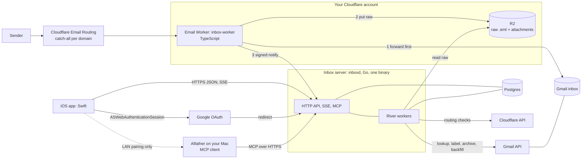

**Design rules**

1. **Delivery never depends on us.** The Worker's first statement is `message.forward()`. Everything after is `try/catch`, nothing rethrows.
2. **R2 is the durable inbox; Go is an idempotent consumer.** If the Go server is down, raw mail is already safe in R2 and a reconciler imports it later.
3. **Postgres is the single stateful dependency of the server.** Jobs, search, events, and app data live there. One server instance is enough at this scale (~35 msgs/day); River's leader election makes scaling out safe later.
4. **Gmail is a mirror, not a source of truth.** We store *desired* Gmail state per message and a reconciler converges Gmail to it (this is what makes Undo, retries, and "14 waiting" simple).
5. **Contract-first.** `api/openapi.yaml` generates the Go server stubs (oapi-codegen) and the Swift client (swift-openapi-generator). A CI check fails on drift.

---

## 3. Stack

| Layer | Choice | Notes |
|---|---|---|
| Edge | Cloudflare Email Worker, TypeScript, `wrangler`, `vitest-pool-workers` | `edge/` |
| Server language | Go 1.23+ | |
| HTTP | `chi` + oapi-codegen strict server | RFC 9457 `application/problem+json` errors |
| DB | Postgres 16/17 via `pgx/v5`, **sqlc** for queries, **goose** for migrations | IDs are UUIDv7 generated in Go (`google/uuid`) |
| Jobs | **River** (`riverqueue/river`) | Cron-style periodic jobs, retries, uniqueness, transactional enqueue |
| Blob | R2 via S3 API (`aws-sdk-go-v2`) | Private bucket; short presigned GETs for attachments |
| MIME | `jhillyerd/enmime` | Parse to parts, decode charsets, inline CIDs |
| HTML→text | `golang.org/x/net/html` | for FTS + snippet |
| Gmail | `google.golang.org/api/gmail/v1` + `x/oauth2` | |
| Cloudflare | `cloudflare-go/v4` | read-only token |
| Rate limit | `x/time/rate` | Gmail ≈ 15 req/s global |
| MCP | `modelcontextprotocol/go-sdk` | Alfather server (§7.9) |
| Auth | Sign in with Apple (identity token verified against Apple JWKS) → opaque device tokens | |
| Crypto | AES-256-GCM, key id column for rotation | Gmail refresh token at rest |
| Observability | `slog` JSON, Prometheus `/metrics` (private), Sentry (Go + iOS), dead-man ping | |
| Hosting | **Fly.io** (1 machine, 512 MB) + **Neon** Postgres (PITR) + Cloudflare R2. Custom domain `api.<yourdomain>` | ≈ $10–15/mo. Any container host works. |
| iOS | Swift 6, SwiftUI, Observation, iOS 17+, **GRDB**, swift-openapi-generator/runtime, Keychain, WKWebView, QuickLook | |
| CI | GitHub Actions (Go, edge, openapi drift), Xcode Cloud or fastlane → TestFlight | |

**Why not Go on Cloudflare Workers?** Go compiles to WASM, but you lose `message.forward`/R2 bindings ergonomics, `pgx`, and most of the Google SDK. A 80-line TS shim is cheaper than that fight.

---

## 4. Core flows

### 4.1 Inbound mail (the hot path)

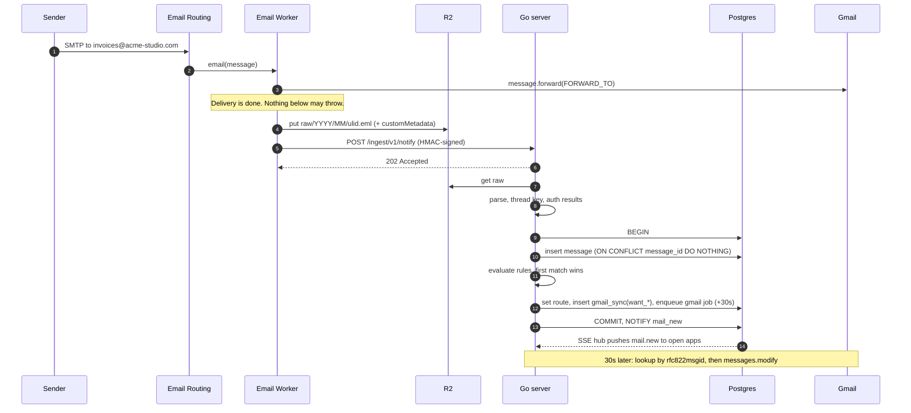

**Failure handling**

| Failure | What happens |
|---|---|
| Go server down / 5xx | Worker retries 3× (0s, 5s, 30s) inside `ctx.waitUntil`. If still failing, nothing is lost: the raw is in R2 with envelope metadata. |
| Worker crashed after R2 put but before notify | `reconcile_r2` (every 5 min) lists R2 keys from the last 48 h that have no `messages.raw_key`, ingests them. |
| R2 put failed | Worker sends a **header-only** notify with `reason=store_failed`. Server creates a `failed` row (no raw) → shows in *Failed*. Retry fetches the message from Gmail by Message-ID (§4.7). |
| Parse error | Row is stored as `failed` with the raw intact; *Retry* re-runs parse after a fix deploys. |
| Duplicate delivery | `UNIQUE(message_id_hdr)`; second insert is a no-op. Missing header → synthetic `sha256(raw)`. |

### 4.2 Rule evaluation

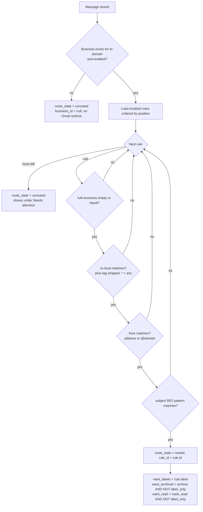

- Patterns use Go's **RE2** (`regexp`), so there's no catastrophic backtracking. Invalid pattern → `422 rule_pattern_invalid` with the compile error and column; the app disables Save and shows the reason (RU07).
- Creating/editing/reordering a rule enqueues `reroute_unrouted` (re-evaluates only `unrouted` messages) so *Rule from this message* actually clears the queue. It never re-routes already-routed mail unless the user taps "Apply to existing".
- Default Gmail behaviour for unrouted mail: **nothing** (no label). The design shows no default-label concept.

### 4.3 Gmail write-back

State is stored in `gmail_sync` (`want_*` vs `applied`). A single job type converges them.

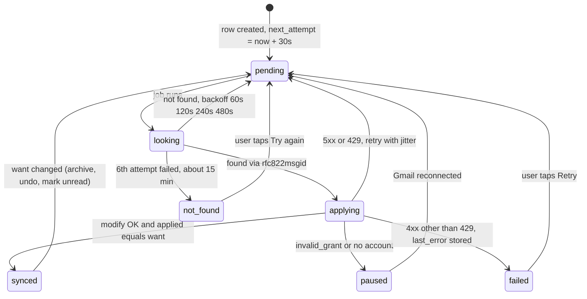

- **Lookup:** `users.messages.list q="rfc822msgid:<id>" includeSpamTrash=true`. Cache `gmail_id` + `gmail_thread_id` on the row.
- **Apply:** one `messages.modify` with computed `addLabelIds` / `removeLabelIds` (`INBOX`, `UNREAD`). Labels are resolved by name; missing ones are created once and cached in `gmail_labels`. Nested names (`Acme/Invoices`) create parents implicitly.
- **Quota:** global limiter 15 req/s, ≤4 concurrent Gmail jobs. `429`/`403 rateLimitExceeded` → honour `Retry-After`, set the River queue to snooze (this is what drives the *Paused by Gmail rate limits* screen, GM09).
- **Reconnect:** when `gmail_accounts.status` flips back to `connected`, flip every `paused` row to `pending`. That's the "14 actions waiting, will run once you reconnect" behaviour (GM03/GM04).

### 4.4 Archive with Undo (5 s)

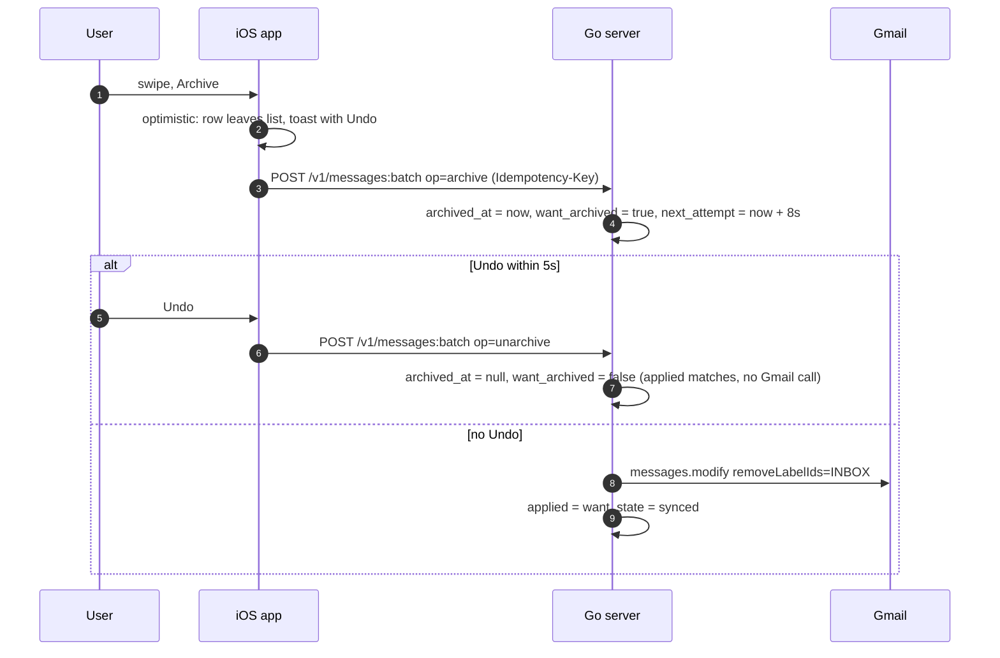

The 8 s Gmail delay (5 s undo + network slack) means Undo is free and never races Gmail.

### 4.5 Gmail connect (OAuth)

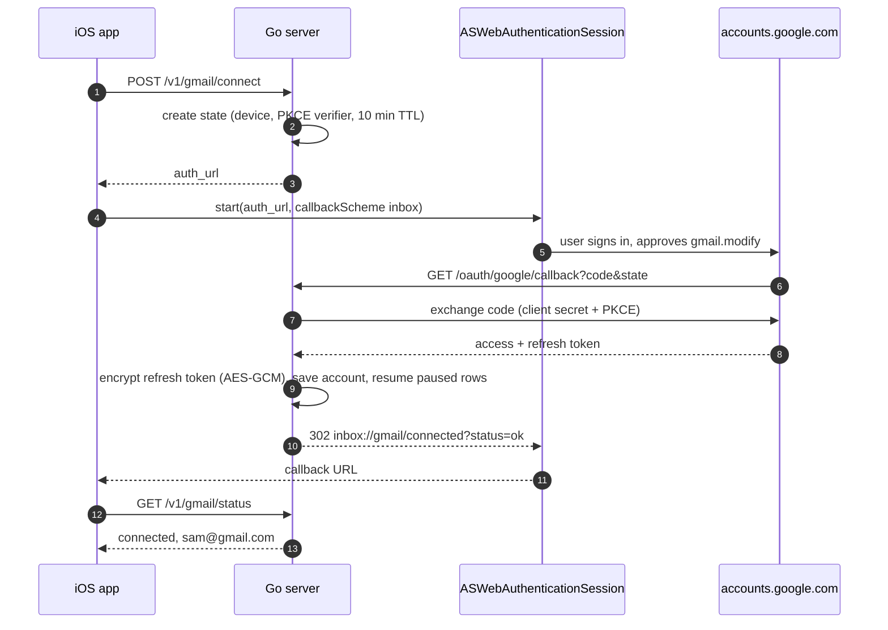

- OAuth client is a **Web** client; redirect URI is `https://api.<domain>/oauth/google/callback`. Publishing status must be **In production** (Testing expires refresh tokens in 7 days). `gmail.modify` is a restricted scope: personal use stays "unverified app" (one warning, ~100-user cap) which is fine here.
- `invalid_grant` on refresh → `status = needs_reauth`, SSE `gmail.status` event, banner (GM02).
- **Spike (M0):** confirm whether `users.settings.filters.list` is covered by `gmail.modify`; if not, add `gmail.settings.basic` and say so on OB05.

### 4.6 Backfill

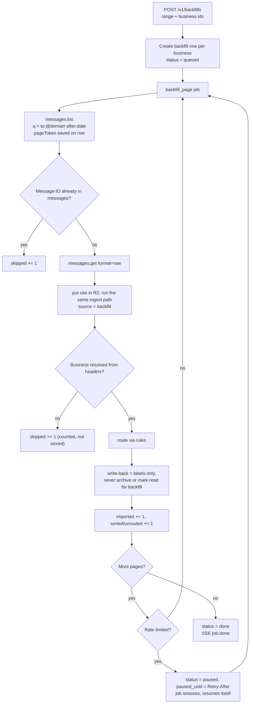

- Recipient for backfilled mail is not an envelope, so business is resolved from `Delivered-To` → `X-Original-To` → `To` → `Cc`, first one on a managed domain. No match → `skipped`.
- Throttled to ~10 messages/s. Re-running any range is safe (dedupe on Message-ID).
- Estimate for OB09 ("About 3,200 messages") = `resultSizeEstimate` from `messages.list` with `maxResults=1`, per business, summed.

### 4.7 Failed items and Retry

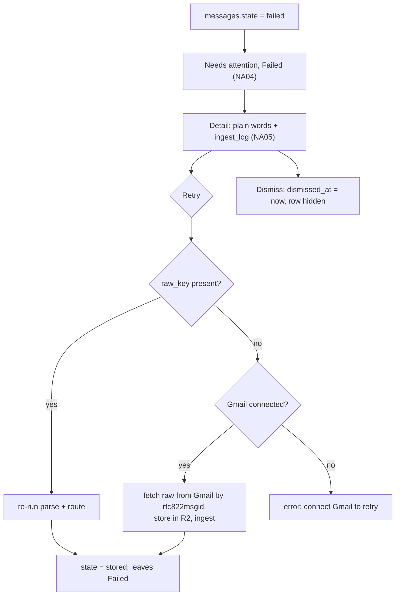

### 4.8 Onboarding (OB01–OB13) ↔ backend

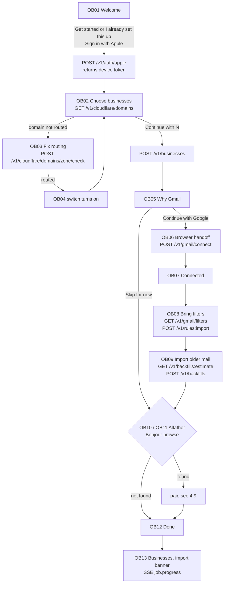

Onboarding progress is also stored server-side (`settings.onboarding_step`) so a reinstall + "I already set this up" lands on the right screen.

### 4.9 Alfather pairing and reading (background only)

Design says Inbox "talks to it over MCP on your own network" and the phone must be on the same network. A cloud-hosted server can't dial a Mac on your LAN, so the plan **inverts the connection**:

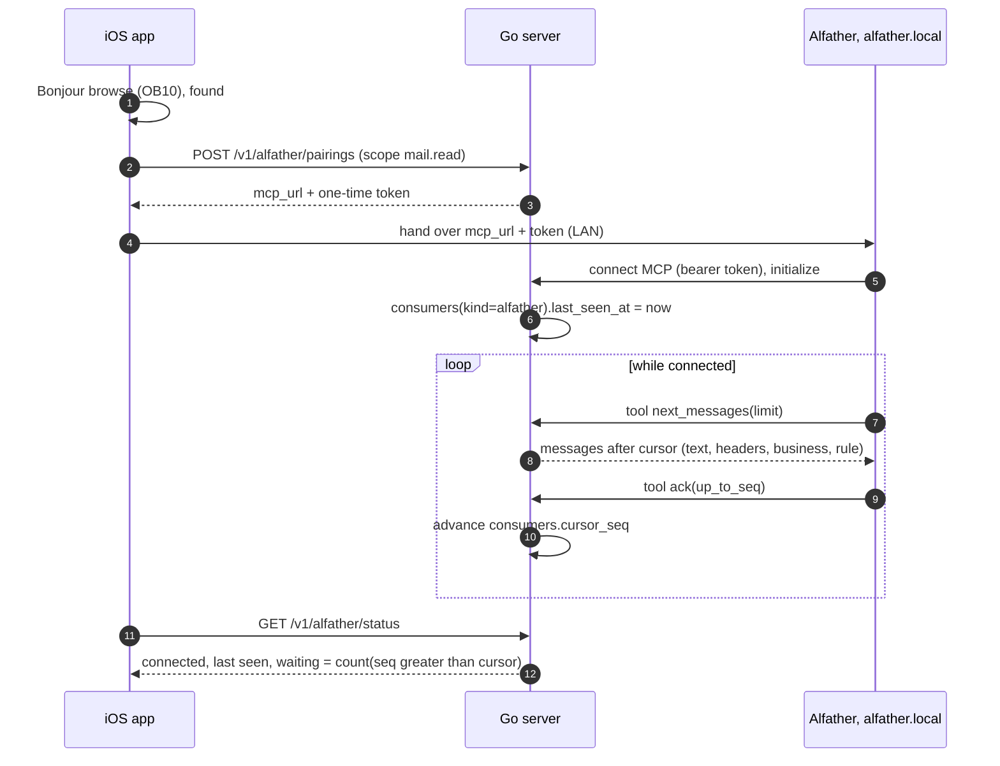

- "Waiting to be read: 41" = messages with `seq > cursor_seq`. "Not reachable · last seen yesterday" = no MCP activity for > 5 min. Mail is never blocked by Alfather.
- **Needs Alfather's real pairing/MCP contract.** This section is the assumption; see §14.

### 4.10 Routing health (Cloudflare)

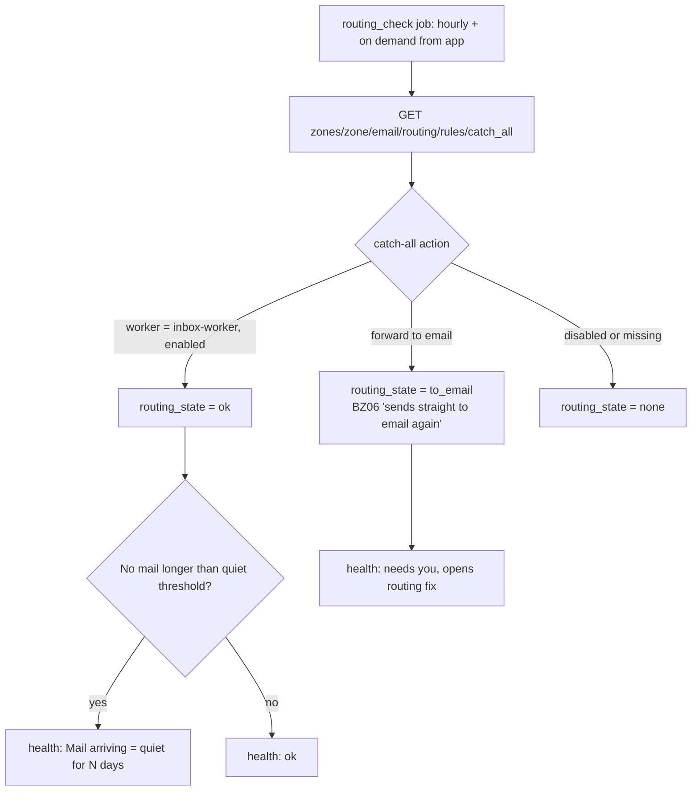

`quiet threshold = max(3 days, 3 × median gap over last 30 days)` so a busy domain flags fast and a rarely-used one doesn't cry wolf.

---

## 5. Data model (Postgres)

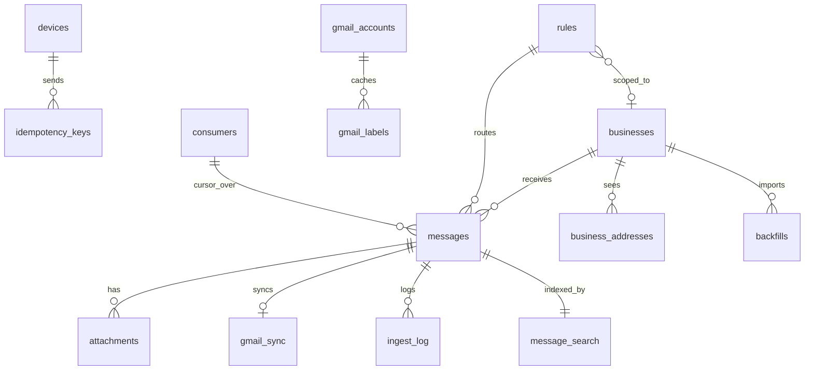

```sql
-- migrations/0001_init.sql (abridged; goose)

CREATE TYPE route_state  AS ENUM ('pending','routed','unrouted');
CREATE TYPE msg_state    AS ENUM ('stored','failed');
CREATE TYPE msg_source   AS ENUM ('edge','backfill','gmail_thread');   -- gmail_thread = your own sent replies
CREATE TYPE msg_dir      AS ENUM ('in','out');
CREATE TYPE gmail_state  AS ENUM ('pending','synced','not_found','failed','paused');
CREATE TYPE routing_state AS ENUM ('ok','to_email','none','unknown');

CREATE TABLE businesses (
  id              uuid PRIMARY KEY,
  name            text NOT NULL,
  domain          text NOT NULL UNIQUE,
  cf_zone_id      text NOT NULL,
  sort_order      int  NOT NULL DEFAULT 0,
  hidden          boolean NOT NULL DEFAULT false,
  enabled         boolean NOT NULL DEFAULT true,
  routing         routing_state NOT NULL DEFAULT 'unknown',
  routing_checked_at timestamptz,
  last_message_at timestamptz,
  created_at      timestamptz NOT NULL DEFAULT now()
);

CREATE TABLE business_addresses (            -- "Addresses seen" (BZ03) + chips (ML02)
  business_id uuid REFERENCES businesses ON DELETE CASCADE,
  local_part  text NOT NULL,                 -- lower-cased, plus-tag stripped
  msg_count   int  NOT NULL DEFAULT 0,
  last_at     timestamptz,
  PRIMARY KEY (business_id, local_part)
);

CREATE TABLE messages (
  id              uuid PRIMARY KEY,
  seq             bigint GENERATED ALWAYS AS IDENTITY,   -- monotonic cursor for Alfather + incremental reads
  business_id     uuid REFERENCES businesses ON DELETE SET NULL,
  direction       msg_dir NOT NULL DEFAULT 'in',
  source          msg_source NOT NULL,
  state           msg_state NOT NULL DEFAULT 'stored',
  failure_reason  text,                       -- machine code; UI maps to plain words
  dismissed_at    timestamptz,
  message_id_hdr  text NOT NULL UNIQUE,       -- RFC 5322 Message-ID, or 'sha256:<hex>' fallback
  env_to          text,                       -- first envelope recipient
  env_to_all      text[] NOT NULL DEFAULT '{}',
  to_local        text,
  to_tag          text,
  from_addr       text, from_name text,
  subject         text, snippet text,         -- snippet = first ~200 chars of text, for list preview
  in_reply_to     text, thread_key text NOT NULL,
  received_at     timestamptz NOT NULL,
  size_bytes      int,
  attachment_count int NOT NULL DEFAULT 0,
  raw_key         text,                       -- null only for failed-without-raw
  auth_results    jsonb,                      -- {"spf":"pass","dkim":"pass","dmarc":"pass"}
  route           route_state NOT NULL DEFAULT 'pending',
  rule_id         uuid REFERENCES rules ON DELETE SET NULL,
  is_read         boolean NOT NULL DEFAULT false,
  read_at         timestamptz,
  archived_at     timestamptz,
  gmail_id        text, gmail_thread_id text,
  created_at      timestamptz NOT NULL DEFAULT now()
);
CREATE INDEX messages_list    ON messages (business_id, received_at DESC, id DESC) WHERE archived_at IS NULL AND state='stored';
CREATE INDEX messages_unread  ON messages (business_id) WHERE NOT is_read AND archived_at IS NULL AND state='stored';
CREATE INDEX messages_addr    ON messages (business_id, to_local, received_at DESC);
CREATE INDEX messages_thread  ON messages (thread_key, received_at);
CREATE INDEX messages_unrouted ON messages (received_at DESC) WHERE route='unrouted' AND state='stored';
CREATE INDEX messages_failed   ON messages (received_at DESC) WHERE state='failed' AND dismissed_at IS NULL;
CREATE INDEX messages_seq     ON messages (seq);

CREATE TABLE message_search (                 -- kept out of the hot table
  message_id uuid PRIMARY KEY REFERENCES messages ON DELETE CASCADE,
  body_text  text,                            -- capped at 200 KB
  fts        tsvector NOT NULL                -- subject A, from B, body C, filenames D
);
CREATE INDEX message_search_fts  ON message_search USING gin (fts);
CREATE INDEX messages_from_trgm  ON messages USING gin (from_addr gin_trgm_ops, from_name gin_trgm_ops);

CREATE TABLE attachments (
  id uuid PRIMARY KEY, message_id uuid NOT NULL REFERENCES messages ON DELETE CASCADE,
  filename text, mime text, size_bytes int, content_id text, inline boolean DEFAULT false,
  r2_key text NOT NULL
);

CREATE TABLE rules (
  id uuid PRIMARY KEY,
  name text NOT NULL,
  position int NOT NULL,                      -- priority; unique among enabled via reorder txn
  enabled boolean NOT NULL DEFAULT true,
  business_id uuid REFERENCES businesses ON DELETE CASCADE,   -- null = any business
  match_to_local text,                        -- 'invoices' | '*' | null = any
  match_from text,                            -- 'a@b.com' | '@b.com' | null = anyone
  match_subject text,                         -- RE2, null = any
  gmail_label text,
  gmail_archive boolean NOT NULL DEFAULT false,
  gmail_mark_read boolean NOT NULL DEFAULT false,
  label_only boolean NOT NULL DEFAULT true,   -- imported rules start true
  imported_from_filter text,
  created_at timestamptz NOT NULL DEFAULT now(), updated_at timestamptz NOT NULL DEFAULT now()
);

CREATE TABLE gmail_accounts (
  id uuid PRIMARY KEY, email text NOT NULL,
  refresh_token_enc bytea NOT NULL, key_id text NOT NULL,
  status text NOT NULL CHECK (status IN ('connected','needs_reauth','revoked')),
  connected_at timestamptz NOT NULL, last_write_at timestamptz
);
CREATE TABLE gmail_labels (account_id uuid, name text, gmail_label_id text, PRIMARY KEY (account_id, name));

CREATE TABLE gmail_sync (                     -- desired vs applied; one row per message that needs Gmail work
  message_id uuid PRIMARY KEY REFERENCES messages ON DELETE CASCADE,
  want_label text, want_archived boolean NOT NULL DEFAULT false, want_read boolean NOT NULL DEFAULT false,
  applied jsonb NOT NULL DEFAULT '{}',        -- {label, archived, read} last confirmed in Gmail
  state gmail_state NOT NULL DEFAULT 'pending',
  attempts int NOT NULL DEFAULT 0, next_attempt_at timestamptz, last_error text,
  labels_only boolean NOT NULL DEFAULT false, -- true for backfill rows
  updated_at timestamptz NOT NULL DEFAULT now()
);
CREATE INDEX gmail_sync_due ON gmail_sync (next_attempt_at) WHERE state IN ('pending','paused');

CREATE TABLE ingest_log (                     -- the "What happened" log in NA05
  id bigserial PRIMARY KEY, ingest_key text NOT NULL,   -- r2 key or message id
  message_id uuid REFERENCES messages ON DELETE CASCADE,
  at timestamptz NOT NULL DEFAULT now(), level text NOT NULL, line text NOT NULL
);

CREATE TABLE backfills (
  id uuid PRIMARY KEY, business_id uuid NOT NULL REFERENCES businesses ON DELETE CASCADE,
  since date NOT NULL, until date,
  status text NOT NULL CHECK (status IN ('queued','running','paused','done','failed','cancelled')),
  page_token text, estimated int, scanned int DEFAULT 0, imported int DEFAULT 0,
  sorted int DEFAULT 0, unrouted int DEFAULT 0, skipped int DEFAULT 0,
  paused_until timestamptz, started_at timestamptz, finished_at timestamptz
);

CREATE TABLE devices (
  id uuid PRIMARY KEY, name text, apple_sub text NOT NULL,
  token_hash bytea NOT NULL UNIQUE,           -- sha256 of 32-byte random token
  created_at timestamptz DEFAULT now(), last_seen_at timestamptz, revoked_at timestamptz
);
CREATE TABLE consumers (                      -- Alfather
  id uuid PRIMARY KEY, kind text NOT NULL, token_hash bytea NOT NULL UNIQUE,
  cursor_seq bigint NOT NULL DEFAULT 0, last_seen_at timestamptz, created_at timestamptz DEFAULT now()
);
CREATE TABLE idempotency_keys (key text, device_id uuid, response jsonb, at timestamptz DEFAULT now(), PRIMARY KEY (device_id, key));
CREATE TABLE settings (key text PRIMARY KEY, value jsonb NOT NULL);   -- retention_days, image_allow_senders[], onboarding_step, ...
```

**Notes**

- `thread_key`: root Message-ID found by following `In-Reply-To`/`References` through existing rows; fallback `sha1(normalised_subject + business_id)`.
- Unread count per business = `COUNT(*) WHERE NOT is_read AND archived_at IS NULL` via the partial index (cheap at this scale; no counters to drift).
- **Search:** server parses the operator string (`from:`, `to:`, `has:attachment`, bare words, quoted phrases) into SQL + `websearch_to_tsquery`; last bare token gets `:*` prefix so "northgate" matches while typing. Results include archived mail (marked), grouped by business in the response.
- River owns its own tables (`river_job`, …); migrate with `river migrate-up`.

---

## 6. Edge Worker (`edge/`)

```ts
// edge/src/index.ts
export default {
  async email(message: ForwardableEmailMessage, env: Env, ctx: ExecutionContext) {
    await message.forward(env.FORWARD_TO);                       // 1. deliver, always first

    try {
      const id = ulid();
      const d = new Date();
      const key = `raw/${d.getUTCFullYear()}/${pad(d.getUTCMonth()+1)}/${id}.eml`;
      const meta = {
        envFrom: message.from, envTo: message.to, rawSize: String(message.rawSize),
        receivedAt: d.toISOString(), messageId: message.headers.get("message-id") ?? "",
      };
      try {
        const fl = new FixedLengthStream(message.rawSize);       // R2 needs a known length for streams
        message.raw.pipeTo(fl.writable);
        await env.RAW.put(key, fl.readable, { customMetadata: meta });
        ctx.waitUntil(notify(env, { key, ...meta }));            // 3 retries inside notify()
      } catch (e) {
        ctx.waitUntil(notify(env, { key: null, reason: "store_failed", ...meta }));
      }
    } catch (e) { console.error("ingest failed", e); }           // never rethrow
  },
};
```

- `notify()` signs `timestamp.body` with HMAC-SHA256 (`INGEST_SECRET`), sends `X-Inbox-Timestamp` / `X-Inbox-Signature`; server rejects >5 min skew and replays (nonce = R2 key, idempotent anyway).
- Secrets/vars: `FORWARD_TO`, `INGEST_URL`, `INGEST_SECRET`; R2 binding `RAW`.
- **M0 spike:** verify `message.raw` can still be read after `forward()`. If not, buffer first (`new Response(message.raw).arrayBuffer()`, ≤25 MiB, well under the 128 MB isolate limit) and then forward immediately; the "forward first" invariant is about not *depending* on anything else, and buffering is local.
- Rollout: switch **one domain at a time** from "Send to email" to "Send to Worker". Rollback is one click in Email Routing.
- Note: Email Routing hard-caps messages at 25 MiB, so the "31 MB too large" example on NA05 can't be produced by size alone; the failure path exists for R2/Worker errors. Keep the screen, change the copy later.

---

## 7. Go backend (`server/`)

### 7.1 Layout

```
inbox/
  api/openapi.yaml                    # single contract
  edge/                               # Cloudflare Email Worker (TS)
  server/
    cmd/inboxd/main.go                # subcommands: serve | migrate | worker-only | admin
    internal/
      config/                         # env parsing, validation
      httpapi/                        # generated server + handlers, middleware (auth, request-id, recover, log)
      auth/                           # Apple JWKS verify, device tokens
      ingest/                         # notify handler, reconcile_r2, parse (enmime), threading, auth-results
      rules/                          # model, matcher, validator, tester (pure, heavily table-tested)
      mail/                           # message queries, batch actions, search parser
      gmail/                          # oauth, client, limiter, lookup, writeback, labels, filters import, thread hydrate
      cloudflare/                     # zones, catch-all check
      backfill/
      health/                         # checks + snapshot
      alfather/                       # MCP server + pairing
      events/                         # LISTEN/NOTIFY → SSE hub
      blob/                           # R2 wrapper, presign
      crypto/                         # AES-GCM envelope
      store/                          # sqlc output, tx helpers
      jobs/                           # River workers + periodic schedule
    db/migrations/*.sql   db/queries/*.sql   sqlc.yaml
    Dockerfile  fly.toml
  ios/                                # §8
```

### 7.2 API surface, mapped to screens

All under `/v1`, `Authorization: Bearer <device token>`, JSON, cursor pagination (`?cursor=` opaque keyset on `(received_at,id)`), errors as problem+json with a stable `code`.

| Area | Endpoint | Screens |
|---|---|---|
| Auth | `POST /auth/apple` → device token · `DELETE /devices/{id}` | OB01 |
| Businesses | `GET /businesses` (name, domain, unread, hidden, routing, last_message_at) · `POST /businesses` · `PATCH /businesses/{id}` (name, hidden, enabled, sort) · `PUT /businesses:order` · `DELETE /businesses/{id}` · `POST /businesses/{id}/routing:check` | ML01, OB13, BZ01–06 |
| Cloudflare | `GET /cloudflare/domains` (zone, domain, routing, selectable) | OB02, BZ05 |
| Mail | `GET /messages?business=&to=&unread=&cursor=` · `GET /messages/{id}` (meta, thread[], attachments[], gmail state, rule, details) · `GET /messages/{id}/body` (html, text, remote_image_count) · `GET /messages/{id}/raw` · `GET /attachments/{id}` (302 to presigned) · `POST /messages:batch` `{ids, op: read\|unread\|archive\|unarchive}` · `POST /messages/{id}/gmail:retry` | ML02–11, MS01–09 |
| Search | `GET /search?q=&business=` (grouped) · `GET/DELETE /search/recents` | SR01–04 |
| Attention | `GET /attention` (unrouted count + failed count, by business) · `GET /attention/unrouted` · `GET /attention/failed` · `POST /failed/{id}:retry` · `POST /failed/{id}:dismiss` | NA01–07 |
| Rules | `GET /rules` · `POST /rules` · `PATCH /rules/{id}` · `PUT /rules:order` · `DELETE /rules/{id}` · `POST /rules:test` (draft rule, optional `scope=unrouted`) · `POST /rules/{id}:apply` | RU01–10, NA03 |
| Gmail | `POST /gmail/connect` · `GET /gmail/status` (account, state, last_write, waiting) · `POST /gmail:disconnect` · `GET /gmail/labels` · `POST /gmail/labels` · `GET /gmail/filters` · `POST /rules:import` | OB05–08, GM01–05, RU04, RU06 |
| Backfill | `GET /backfills:estimate?days=&businesses=` · `POST /backfills` · `GET /backfills` · `POST /backfills/{id}:pause\|resume\|cancel` | OB09, GM06–09, OB13 |
| Alfather | `POST /alfather/pairings` · `GET /alfather/status` · `DELETE /alfather` | OB10–11, AF01–04 |
| Health | `GET /health` (checks[] each with `state`, `message`, `fix_route`) | ST05, ST06 |
| Settings | `GET/PUT /prefs` (`retention_days`, `image_allow_senders`, `preview_lines`) · `DELETE /data` (purge stored copies, confirm token) | ST03, ST04 |
| Live | `GET /events` (SSE): `mail.new`, `gmail.status`, `job.progress`, `health.changed`; 20 s heartbeat | ML08, OB13 |
| Ingest (not for the app) | `POST /ingest/v1/notify` (HMAC) | — |
| OAuth | `GET /oauth/google/callback` (no bearer; state-bound) | OB06 |

`Idempotency-Key` is required on every mutating call from the app (stored 24 h).

### 7.3 Job catalogue (River)

| Job | Trigger | Retries | Notes |
|---|---|---|---|
| `ingest_process` | notify, reconcile, retry | 5, exp backoff | parse → store → route → enqueue `gmail_writeback` in the same tx |
| `gmail_writeback` | per `gmail_sync` row, `ScheduledAt` = `next_attempt_at` | handled in-job (see §4.3) | unique by `message_id`; coalesces repeated wants |
| `thread_hydrate` | after Gmail lookup succeeds, once per `gmail_thread_id` | 3 | imports your **sent** replies as `direction='out'` |
| `reroute_unrouted` | rule create/edit/reorder | 3 | |
| `backfill_page` | backfill row | until done | pause/snooze on 429 |
| `reconcile_r2` | every 5 min | — | lists last 48 h of `raw/` keys |
| `routing_check` | hourly + on demand | 3 | Cloudflare API |
| `health_snapshot` | every 5 min | — | writes `settings.health`, emits `health.changed`, pings dead-man URL |
| `prune` | daily 03:00 | — | applies retention: delete rows older than `retention_days` and their R2 objects; purge old `idempotency_keys`, `ingest_log` |

### 7.4 Health model

| Check | Source | States |
|---|---|---|
| Mail arriving (per business) | `routing` + `last_message_at` vs quiet threshold | ok · quiet N days · routing broken |
| Worker | last 24 h of notify results; `ingest_log` errors | running · running, N errors today · silent > 24 h with routing ok |
| Gmail | `gmail_accounts.status`, waiting count | connected · signed out, N waiting · rate-limited |
| Queue | River stats (available + retryable + discarded) | ok · N waiting · stuck (oldest > 15 min) |
| Alfather | `consumers.last_seen_at`, waiting | connected · not reachable |

Each check returns `{state, message, fix_route}` where `fix_route` is an app route id (`gmail`, `business/{id}/routing`, `alfather`), which is how "opens the screen that fixes it" works without the client knowing the rules.

### 7.5 Rendering contract (`GET /messages/{id}/body`)

Returns the HTML **as sent** (no sanitising that changes appearance; scripts can't run client-side anyway), plus `cid` parts untouched (`cid:` URLs stay; the app resolves them through a custom URL scheme handler), `remote_image_count`, and `text` fallback. Plain-text messages are returned as `text` only; the app lays them out natively. Also returns `auth_results` for Original (MS08).

### 7.6 Security

- Device tokens: 32 random bytes, stored as SHA-256; revocable. Apple identity token must match `OWNER_APPLE_SUB` (env) once claimed; first claim requires `BOOTSTRAP_CODE` (printed by `inboxd admin bootstrap`) so an unclaimed public server can't be taken over.
- Ingest endpoint: HMAC + timestamp window; also IP-allowlist not used (Workers' egress IPs are shared).
- Gmail refresh token: AES-256-GCM, `key_id` column, key from env/secret store. Never logged.
- R2 bucket private; attachment downloads are 60-second presigned URLs minted after the bearer check.
- Rate limits: per-device token bucket on the API; stricter on `/auth/*`.
- Logs carry message UUIDs, never subjects/addresses/bodies at INFO.
- Delete-everything endpoint requires a typed confirmation token from a prior call.

### 7.7 Testing (server)

- `rules/`: exhaustive table tests + fuzz on matcher/validator.
- `ingest/`: a corpus of real `.eml` fixtures (multipart/alternative, inline CIDs, non-UTF-8 charsets, forwarded-as-attachment, huge headers, missing Message-ID, calendar invites).
- Integration: `testcontainers-go` Postgres + MinIO for R2 + a fake Gmail HTTP server (`httptest`) with scripted failures (404-then-200, 429 with Retry-After, `invalid_grant`).
- Contract: Schemathesis against the running server from `openapi.yaml`.
- Local ingest: `curl -X POST 'http://localhost:8787/cdn-cgi/handler/email?from=a@x.com&to=invoices@acme.com' --data-binary @fixtures/invoice.eml` through `wrangler dev` pointing at a local `inboxd`.

---

## 8. iOS app (`ios/`)

### 8.1 Project structure

```
ios/
  Inbox.xcodeproj                      # thin app target: entry point, Info.plist, entitlements, assets, fonts
  InboxKit/                            # local Swift package
    Package.swift
    Sources/
      DesignSystem/                    # tokens, fonts, components (Row, Chip, Banner, Toast, Sheet, Switch…)
      API/                             # generated client + AuthMiddleware + ProblemError + SSEClient
      Persistence/                     # GRDB database, migrations, records, observations
      Domain/                          # models, repositories (Mail, Business, Rules, Gmail, Backfill, Health…)
      Web/                             # MessageWebView, content rules, CID scheme handler
      FeatureOnboarding/ FeatureMail/ FeatureMessage/ FeatureSearch/
      FeatureAttention/ FeatureRules/ FeatureBusinesses/ FeatureGmail/
      FeatureAlfather/ FeatureSettings/
    Tests/
```

### 8.2 Architecture

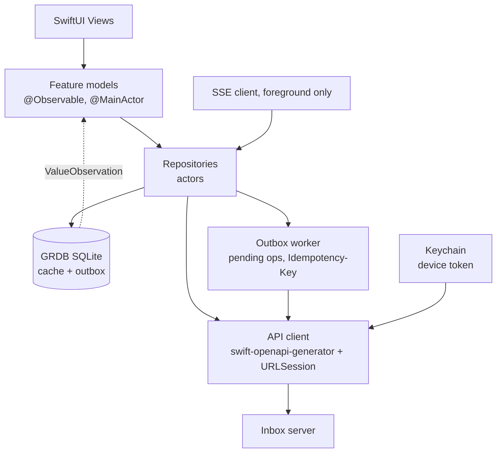

- **Pattern:** stale-while-revalidate. Views observe GRDB; a repository call renders cache immediately, then refreshes from the network and upserts. This gives the design's skeleton rows only on a cold cache.
- **Optimistic writes + outbox:** read/unread/archive mutate the local row immediately and append to `pending_ops` (kind, payload, idempotency key). The outbox flushes when `NWPathMonitor` says online; the server's idempotency table makes replays safe. Undo = enqueue the inverse before the first op has been sent, which cancels both.
- **Live updates:** SSE while foregrounded (`mail.new` → refetch active list; `job.progress` → import banner; `gmail.status` → banner; `health.changed` → Settings row). No background fetch in v1 beyond an opportunistic `BGAppRefreshTask`.
- **Concurrency:** Swift 6 strict concurrency; repositories are actors; models are `@MainActor`.
- **Local schema (GRDB):** `business`, `message` (list fields only), `message_body` (HTML on disk in `Caches/`, LRU 200 MB), `thread_item`, `rule`, `pref`, `recent_search`, `pending_op`. Cache bounded to last 90 days of list rows; older mail is fetched on demand.

### 8.3 Navigation

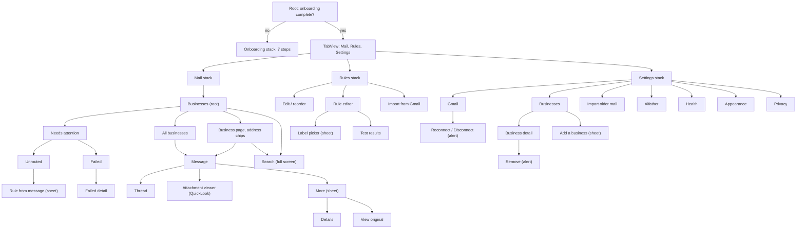

`NavigationStack(path:)` per tab with a typed `Route` enum; `fix_route` strings from `/health` map to routes. Deep links: `inbox://gmail/connected`, `inbox://message/{id}`, `inbox://settings/health`.

### 8.4 Message rendering (security-critical)

- `WKWebView` with `WKWebpagePreferences.allowsContentJavaScript = false`, non-persistent `WKWebsiteDataStore`.
- A compiled **`WKContentRuleList`** blocks everything except `data:` and the `inbox-cid:` scheme. "Load images" for a sender compiles a second rule list allowing `image` loads for that message and stores the sender in `prefs.image_allow_senders` (server-side, so it survives reinstall).
- `WKURLSchemeHandler("inbox-cid")` resolves `cid:` parts from the attachments API with the bearer token (subresource requests can't carry headers otherwise).
- Link taps are intercepted (`decidePolicyFor`) → `SFSafariViewController`; `mailto:` → ignore in v1.
- Body background forced to white and `color-scheme: light` so "senders' bodies stay on white, as sent" holds in dark mode.
- Height: native header + web content inside one `ScrollView`; web view `isScrollEnabled = false`, height from `contentSize` KVO.
- Plain text: native `Text` with link detection.
- Attachments: download to a temp file, `QLPreviewController`, share sheet.
- "Open in Gmail": `googlegmail:///` if `canOpenURL`, else `https://mail.google.com/mail/u/0/#all/<gmail_id>`.

### 8.5 Design system

Tokens straight from the Foundations board; one `Theme` environment value, light/dark/system, set from Appearance.

```swift
public struct Palette: Sendable {
    public let ground, card, grouped, hairline, text, secondary, tertiary, accent, onAccent: Color
}
public extension Palette {
    static let light = Palette(ground: .hex(0xF1E9D2), card: .hex(0xF7F1E2), grouped: .hex(0xE9DEC0),
        hairline: .hex(0xDCCFBC), text: .hex(0x461634), secondary: .hex(0x7A5268), tertiary: .hex(0xA68C97),
        accent: .hex(0xF83D34), onAccent: .hex(0xF1E9D2))
    static let dark = Palette(ground: .hex(0x1A0F16), card: .hex(0x24151F), grouped: .hex(0x130A10),
        hairline: .hex(0x36222F), text: .hex(0xF3EBD8), secondary: .hex(0xC2AFB8), tertiary: .hex(0x7E6B76),
        accent: .hex(0xFF5B45), onAccent: .hex(0x1A0F16))
}
```

- Fonts: **PolySans** (headings), **TWK Lausanne** (body; 300 text, 500 sender/unread), **GT America Mono** (logs, headers). Files are already in `/fonts`; register via `UIAppFonts`. **Confirm the licences allow app embedding.** Use `Font.custom(_:size:relativeTo:)` so Dynamic Type works.
- Components to build once and reuse: `MailRow` (unread dot, skeleton variant, swipe + select modes), `Chip`, `InsetGroup`/`InsetRow`, `SquareSwitch` (the rounded-square toggle), `Banner`, `Toast` (Undo), `Sheet`, `DestructiveAlert`, `StatusDot`, `EmptyState`, `ProgressBar`, `TabBar` (accent bar on active tab).
- **Accessibility flag for design:** accent `#F83D34` on cream `#F1E9D2` is ≈ **3.0 : 1**, below 4.5 : 1 for 17 pt regular text (back buttons, "Fix", "Undo", links). Fine for large/bold or non-text; for text either darken the text-use accent (≈ `#C8281F`) or make those labels semibold. Decide before building tokens.
- Accessibility basics: every swipe action also exposed via `accessibilityAction`; unread dot has a label; minimum 44 pt targets; reduce motion for the toast and sheet.

### 8.6 Key view-model contracts (sketch)

```swift
@MainActor @Observable final class BusinessPageModel {
    var business: Business; var chips: [AddressChip]; var selected: String?   // nil = All
    private(set) var rows: [MessageRow] = []; private(set) var phase: Phase = .loading
    func onAppear() async; func refresh() async; func loadMore() async
    func archive(_ ids: Set<Message.ID>) async     // optimistic + outbox + toast(undo)
    func toggleRead(_ ids: Set<Message.ID>) async
}
enum Route: Hashable {
    case business(Business.ID, address: String?), message(Message.ID), details(Message.ID), original(Message.ID)
    case attention, unrouted, failed, failedDetail(Message.ID), search(scope: Business.ID?)
    case rule(Rule.ID?), ruleTest(DraftRule), importFilters
    case settings(SettingsRoute)
}
```

### 8.7 Testing (iOS)

- Swift Testing for repositories, outbox replay, optimistic/undo, search-operator formatting, route mapping.
- **Snapshot tests per canvas board** (390×844, light + dark, default + AX3 Dynamic Type) with `swift-snapshot-testing`. Board ids (`ML02`, `MS04`, …) are the test names, so design review diffs are mechanical.
- UI tests against `inboxd` running in Docker with seeded fixtures: onboarding happy path, archive+undo, rule create+test, Gmail disconnected banner (server flag).
- WebView security tests: a fixture HTML with `<script>`, remote ``, `<link>`, `<meta refresh>`, CSS `@import`, `<form>` must produce **zero** network requests and zero JS execution.

---

## 9. Screen → API → data traceability

| Board group | Key screens | Reads | Writes | Notes |
|---|---|---|---|---|
| Onboarding OB01–13 | Welcome … Done | `/cloudflare/domains`, `/gmail/status`, `/gmail/filters`, `/backfills:estimate`, SSE | `/auth/apple`, `/businesses`, `/gmail/connect`, `/rules:import`, `/backfills`, `/alfather/pairings` | resumable via `settings.onboarding_step` |
| Mail ML01–11 | Businesses, Business page, filter, All, swipe, select, refresh, states | `/businesses`, `/messages` | `/messages:batch` | skeleton = no cache; empty states from counts |
| Message MS01–09 | reading, thread, images, attachment, More, Details, Original, Gmail not found | `/messages/{id}`, `/body`, `/raw`, `/attachments/{id}` | `/messages:batch`, `/gmail:retry`, `/prefs` | DKIM/SPF/DMARC from `auth_results` |
| Search SR01–04 | idle, results, scoped, none | `/search`, `/search/recents`, `/backfills` (hint) | recents | "import still running" hint from active backfill |
| Attention NA01–07 | group, Unrouted, Rule-from-message, Failed, detail, retrying, none | `/attention*`, `/rules:test scope=unrouted` | `/rules`, `/failed/{id}:retry/dismiss` | group hides when both counts are 0 |
| Rules RU01–10 | list, edit order, none, import, editor, label, invalid, test, none, delete | `/rules`, `/gmail/labels`, `/gmail/filters` | `/rules*`, `/gmail/labels`, `/rules:order` | validation error text comes from server |
| Businesses BZ01–06 | list, reorder, detail, remove, add, routing problem | `/businesses`, `/cloudflare/domains` | `/businesses*`, `/routing:check` | remove = delete rows + R2 objects |
| Gmail GM01–09 | connected, signed out, reconnect, catching up, disconnect, import setup/running/done/paused | `/gmail/status`, `/backfills` | `/gmail/connect`, `/gmail:disconnect`, `/backfills` | waiting = count of `paused`/`pending` rows |
| Alfather AF01–04 | set up, connected, reconnecting, not reachable | `/alfather/status` | `/alfather/pairings` | |
| Settings ST01–06 | root, problems, appearance, privacy, health ok / needs you | `/health`, `/prefs` | `/prefs`, `DELETE /data` | |

---

## 10. Environments, CI/CD, operations

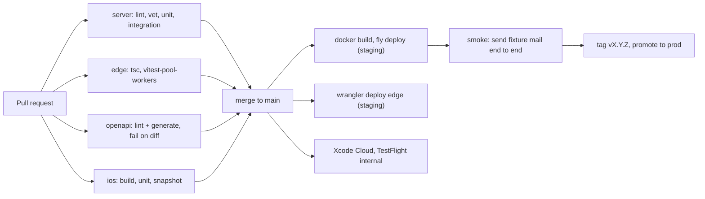

- **Two environments:** `staging` (own domain, own R2 bucket, own Postgres branch, Gmail test account) and `prod`. Cloudflare Email Routing for a throwaway domain points at the staging Worker.
- **Rollout:** domain-by-domain (§6). Keep Gmail filters in place until the matching rule is imported and labelled correctly in label-only mode.
- **Backups:** Neon PITR; nightly `pg_dump` to a second R2 bucket; R2 object versioning on `raw/`. Restore drill once before launch.
- **Runbook (one page):** "mail missing in app" → check Worker logs, R2 key exists?, `reconcile_r2`, `ingest_log`; "labels not applying" → `gmail_sync` states, account status; "Gmail signed out" → reconnect.
- **Alerts:** dead-man ping from `health_snapshot` (silence = server or DB down), Sentry on error spikes, `/readyz` external check.
- **Cost expectation:** Fly ≈ $5, Neon free/≈$5, R2 pennies (≈1.3 GB/yr at current volume), Workers Paid $5 for CPU headroom.

---

## 11. Risks

| Risk | Mitigation |
|---|---|
| Worker bug blocks delivery | `forward()` first; try/catch; per-domain rollout; one-click rollback |
| Can't read `message.raw` after `forward()` | M0 spike; fallback is to buffer first, then forward (§6) |
| Go server down | R2 holds mail; Worker retries; `reconcile_r2` catches up; alert via dead-man |
| Gmail copy not found | 6 tries over 15 min, then `not_found` with *Try again* |
| Refresh token revoked | "In production" OAuth; `needs_reauth` banner; actions queue and resume |
| Gmail restricted-scope policy | Personal use, unverified app; no public distribution |
| Rules fight Gmail filters | Imported rules start label-only; copy tells the user to delete the Gmail filter first |
| Malicious HTML / tracking | JS off, remote loads blocked, tested with hostile fixtures |
| Same Message-ID to two businesses | One row, first business wins, extra recipients kept in `env_to_all`; matches Gmail's single copy |
| Apple/Google/Cloudflare API drift | Thin wrappers with contract tests against recorded fixtures |
| Font licences | Verify embedding rights before TestFlight |
| Single instance = single point of failure | Acceptable for personal use; River + Postgres allow a second instance with no code change |

---

## 12. Definition of done (v1)

- A real email to each connected domain appears in the app in **< 5 s p95**, and the Gmail copy is labelled within **~60 s** when Gmail is connected.
- Killing `inboxd` for an hour loses **zero** mail after restart.
- Archive + Undo within 5 s produces **no** Gmail write.
- Every board in the canvas has a passing snapshot test (light + dark).
- Hostile HTML fixtures make **no** network requests.
- A cold install on a fresh phone completes onboarding using only the app plus the four Cloudflare steps.

---

## 13. Milestones (one dev, ~10 weeks)

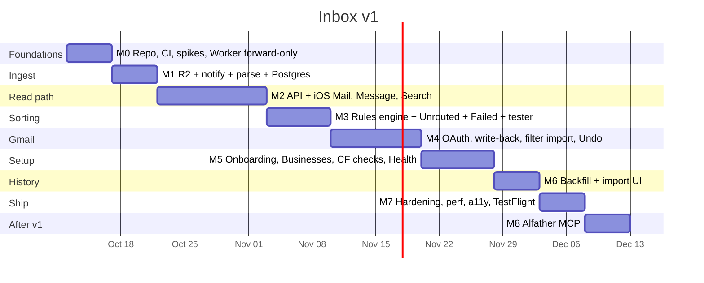

| # | Deliverable | Exit criteria |
|---|---|---|
| **M0** | Monorepo, `openapi.yaml` skeleton, CI, Fly + Neon + R2 staging, Worker forward-only on one test domain. **Spikes:** raw-after-forward, filters scope, Alfather contract, font licence | Test domain mail still reaches Gmail via the Worker; spike results written down |
| **M1** | Worker → R2 → notify → `ingest_process` → `messages` + FTS; reconciler | Every test mail is in Postgres with raw in R2; kill-server test passes |
| **M2** | Auth (SIWA, device tokens), businesses (manual seed), messages/search endpoints, iOS shell, design system, Mail + Message + Search, SSE | You can read the test domain's mail on a phone, light + dark |
| **M3** | Rules CRUD/reorder/test, Unrouted + Failed, rule-from-message | Mail groups by rule; test screen shows "caught earlier by …" |
| **M4** | Gmail OAuth, lookup + write-back state machine, labels, archive/read, Undo, filter import, banner/reconnect | Labels appear in Gmail; disconnect/reconnect drains the queue |
| **M5** | Cloudflare domain list + routing checks, Add/Remove/Reorder business, onboarding, Health, Settings screens | Fresh install completes onboarding; broken routing shows the fix |
| **M6** | Backfill with pause/resume, estimates, progress UI | 90 days imported with correct sorted/unrouted/skipped counts; re-run is a no-op |
| **M7** | Retention + purge, accessibility pass, perf (list at 60 fps with 10k rows), crash reporting, TestFlight | §12 all green |
| **M8** | Alfather pairing + MCP tools (`next_messages`, `ack`, `get_message`, `search`) | Waiting count drains; "not reachable" state honest |

M0–M3 need no Google setup. Each milestone ships on its own.

---

## 14. Gaps in the design and decisions I made (shout if wrong)

1. **No sign-in screen.** The backend must know who is calling. *Decision:* **Sign in with Apple** behind "Get started" / "I already set this up" (system sheet, no custom UI), server allow-lists your Apple `sub`. Alternative: passkeys. Needs an Apple Developer account.
2. **Alfather transport.** Design implies the phone talks to Alfather on the LAN; a hosted server can't reach it. *Decision:* **invert it**: the phone only discovers and pairs (hands Alfather an MCP URL + scoped token); Alfather connects out to the server's MCP endpoint (§4.9). I need Alfather's actual pairing/MCP interface before M8.
3. **Threads show "Sam (you)" replies** (MS03), but replies you send from Gmail never pass through the Worker. *Decision:* after a Gmail match, `thread_hydrate` imports messages in that Gmail thread carrying the `SENT` label as read-only `direction='out'`. Requires Gmail connected; without it threads show inbound mail only.
4. **Read state vs Gmail.** *Decision:* opening a message marks it read **in Inbox only**. Gmail's UNREAD changes only when a rule says *mark as read* or the user taps Unread/Read on a row **and** the Gmail "Archive when rules say so / Apply labels" settings allow it. (Easy to flip to full mirroring.)
5. **Archive semantics.** There's no "Archived" view in the IA. *Decision:* archived mail is hidden from lists but included in Search (marked "Archived").
6. **Backfill write-back.** *Decision:* backfilled mail gets **labels only**, never archived or marked read, so importing 90 days doesn't empty your Gmail inbox.
7. **Remove business.** Copy says stored copies are deleted. *Decision:* rows + R2 objects removed; re-adding later offers a re-import.
8. **Retention.** "Stored copies: 1 year" deletes both the copy and the row (mail disappears from the app, stays in Gmail).
9. **Privacy copy** (ST04) says "index (D1)". Change to the Inbox server.
10. **NA05 "31 MB over the 25 MB limit"** can't occur (Email Routing caps at 25 MiB); keep the failure path, change the example copy.
11. **Accent contrast** (§8.5): decide before tokens are frozen.
12. **Dynamic Type / iPad:** design is fixed 390 pt; the plan supports Dynamic Type, no iPad layout in v1.
13. **Push notifications:** not designed and not planned (Gmail already notifies). If wanted: APNs from a `mail.new` hook, one setting, 2–3 days.

---

## 15. First week, concretely

1. Create the monorepo (`server/ edge/ ios/ api/`), CI skeletons, `openapi.yaml` with `/healthz`, `/v1/businesses`, `/v1/messages`.
2. Provision: Fly app, Neon DB, R2 bucket (+ staging), `api.` and `inbox-worker` routes.
3. Ship the forward-only Worker on **one** spare domain; send test mail; confirm Gmail still gets everything.
4. Run the four spikes and write results at the bottom of this file.
5. Pick the M0 test domain, the backfill window default (recommend **90 days**, as in OB09), and whether routed mail defaults to **label + archive** or **label only** (recommend **label only** until the matching Gmail filter is deleted, per the design).
